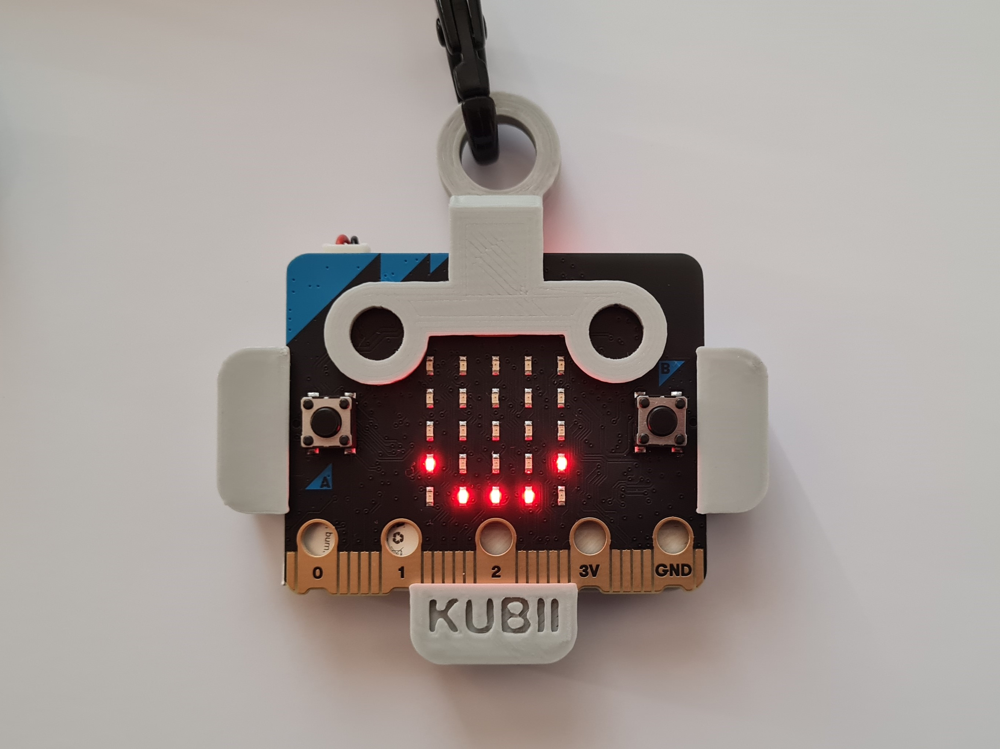

# Badge-Microbit

Ce badge animé en forme de tête de robot stylisée est prévu pour être porté avec une longe de tour de cou.  
Il supporte une carte Micro:bit BBC V2.21 et une batterie rechargeable Lipo 250mAh 3,7V.  
Les animations sont les suivantes :  
-	« Scrolling du nom CALIBAN» Association Française de robotique amateur  
https://www.facebook.com/AssoCaliban;
-	« Smile » du robot avec mélodie (appuie sur Bouton poussoir « A »)
-	« Cœur » qui bat avec bruitage (appuie sur Bouton poussoir « B ») 

La mélodie ou le bruitage peuvent êtres désactivés pour chaque animation par un appuie sur l’autre bouton (Ex : Appuie sur « B » si animation encours est « Smile », ou Appuie sur « A » si animation encours est « Coeur »)  
La carte peut être mise en mode d'économie d'énergie en maintenant enfoncée le bouton de Reset au dos. Lorsque la LED d'alimentation s'éteint, relâchez le bouton pour mettre votre micro:bit en mode d'économie d'énergie.  
Un appuie court sur le même bouton redémarre la carte.  

Dans ce dossier vous trouverez toutes les informations pour le construire et le programmer :
-	Les fichiers STL pour l’impression
-	Une liste du matériel et une suggestion de liens pour se le procurer
-	Un fichier de programmation « caliban.hex» prêt à être téléchargé dans la carte Micro:bit. Pour cela vous devez raccorder la carte à votre PC par un câble USB, puis copier/coller le fichier dans le répertoire de la carte Micro:bit qui apparait dans l’arborescence de votre ordinateur. Le chargement commence automatiquement.
-	Le code Python pouvant être modifié avec l’éditeur:  https://python.microbit.org/?l=fr

La recharge de la batterie doit être réalisée à part, avec un chargeur Lipo 1s tel que celui référencé dans le fichier de liste du matériel « BOM Microbit holder »

Une démo au lien suivant: https://youtu.be/-zeMkWJXh7k  
Une vidéo de l'assemblage: https://youtu.be/kdMkO-jAXIA
